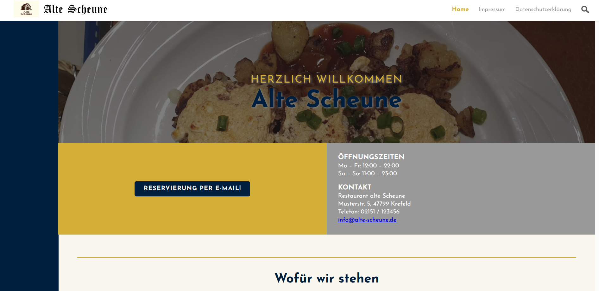
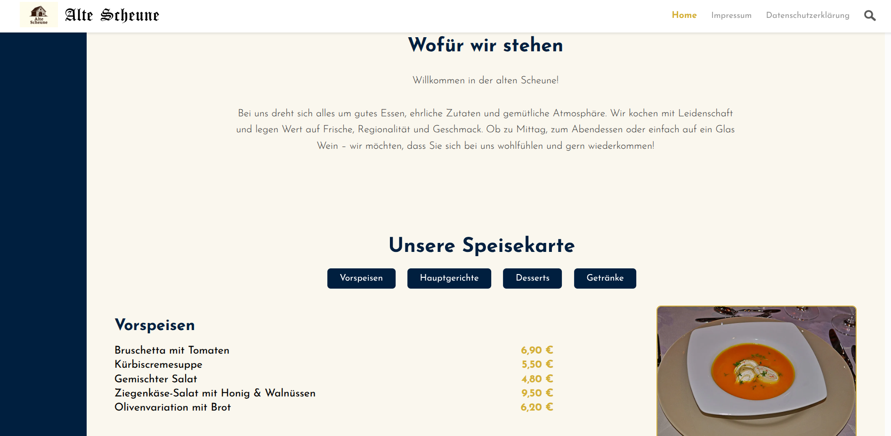
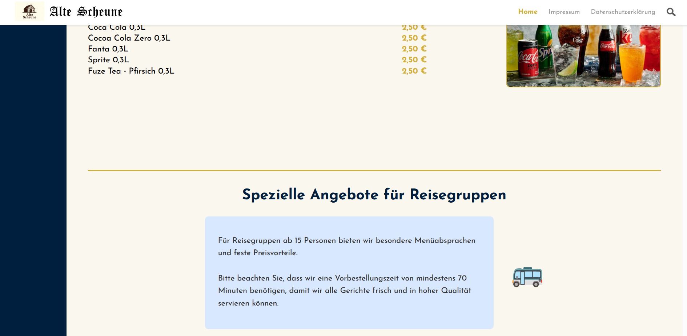
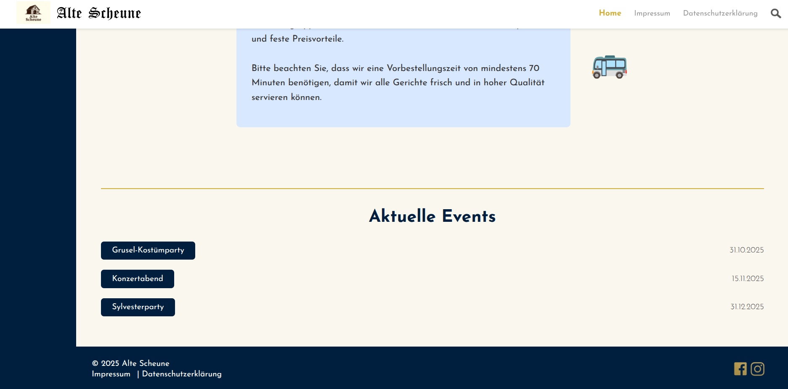
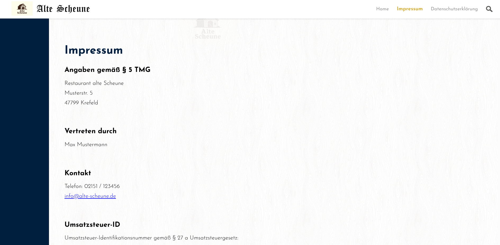
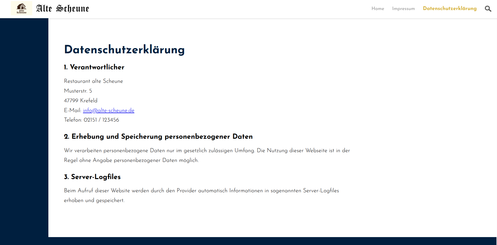
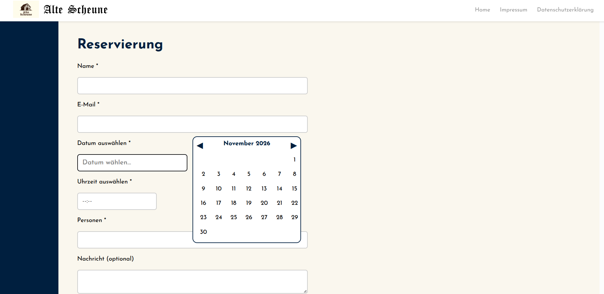
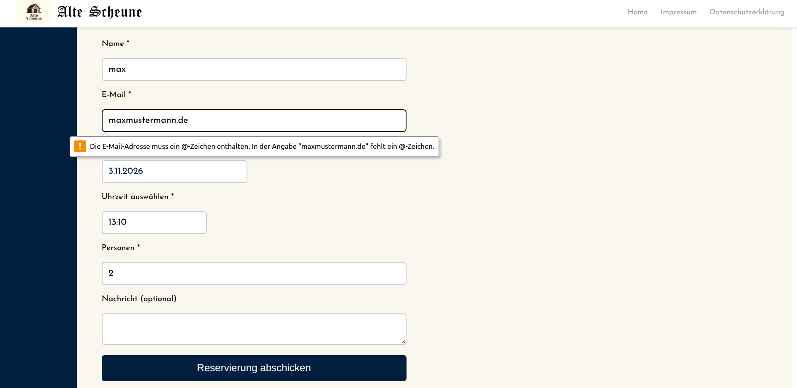

# Web Engineering – Restaurant-Website „Alte Scheune“

Studienprojekt aus dem Modul **Web Engineering** an der Hochschule Niederrhein: Umsetzung einer Restaurant-Website mit HTML, CSS und JavaScript.

## Projektablauf

Eine andere Projektgruppe stellte das Lastenheft bereit. Auf dieser Grundlage entwickelte unsere Gruppe die Website und erstellte das zugehörige Pflichtenheft sowie eine Testdokumentation. Das ursprüngliche Lastenheft unserer eigenen Gruppe gehört nicht zu diesem Repository.

## Team

Gemeinsame Umsetzung: Metin Arslancan und Merve Karadag (Gruppe 47). Die einzelnen Beiträge werden hier nicht getrennt ausgewiesen.

## Website und Umsetzung

Die Website stellt Restaurantinformationen, Speisekarte, Reisegruppenangebote und Veranstaltungen bereit. Das im Pflichtenheft beschriebene Erscheinungsbild kombiniert Dunkelblau, Gold und helle Flächen mit einem dunkelblauen Seitenbalken und einer festen Hauptnavigation.

| Technologie | Verwendung |
| --- | --- |
| HTML5 | Seitenstruktur, Navigation, Links und Formularfelder |
| CSS | Farben, Schriftarten, Layout, Hintergründe und Media Query für kleinere Fenster |
| JavaScript | Seitensuche, Kalender, Uhrzeitauswahl und Formularverarbeitung im Browser |

### Ansichten der Website

#### Startseite und Navigation



Der Einstieg kombiniert ein großflächiges Essensfoto mit einem abgedunkelten Overlay und einer Begrüßung in Gold und Dunkelblau. Darunter stehen der Zugang zum Reservierungsformular sowie Öffnungszeiten und Kontaktdaten. Die oben fixierte Navigation enthält Logo, Seitentitel, Links zu Home, Impressum und Datenschutz sowie das Lupensymbol für die Suche.

#### Restaurantvorstellung und Speisekarte



Der Abschnitt „Wofür wir stehen“ stellt das Restaurant vor. Über die dunkelblauen Kategorien Vorspeisen, Hauptgerichte, Desserts und Getränke gelangt man zum jeweiligen Abschnitt der Speisekarte. Gerichte und goldfarbene Preise stehen neben einem passenden Bild pro Kategorie. Diese Kategoriennavigation und Bildanordnung sind im Pflichtenheft als abgestimmte Anpassungen beschrieben.

#### Informationen für Reisegruppen



Eine hellblaue Informationsbox beschreibt die im Projekt vorgesehenen Angebote für Reisegruppen ab 15 Personen und eine Vorbestellungszeit von mindestens 70 Minuten. Ein Bus-Emoji ergänzt den Abschnitt; eine goldene Linie trennt ihn vom übrigen Inhalt.

#### Veranstaltungen und Fußbereich



Die Eventübersicht listet eine Grusel-Kostümparty, einen Konzertabend und eine Silvesterparty mit Terminen aus der Projektabgabe von 2025. Die dunkelblauen Schaltflächen öffnen die zugehörigen PDF-Flyer. Der dunkelblaue Footer enthält Links zu Impressum und Datenschutz sowie goldfarbene Social-Media-Symbole.

#### Impressum



Die separate Impressumsseite übernimmt die Navigation und den dunkelblauen Seitenbalken. Ein dezentes Holzmuster und das Logo als Wasserzeichen gestalten den Hintergrund. Die Seite enthält die im Projekt verwendeten Anbieter- und Kontaktdaten; die E-Mail-Adresse ist als mailto-Link eingebunden.

#### Datenschutzerklärung



Die Datenschutzseite verwendet einen weißen Hintergrund und eine dunkelblaue Überschrift. Der gezeigte Ausschnitt gliedert die Projekttexte in Verantwortliche, personenbezogene Daten und Server-Logfiles. Die Darstellung dokumentiert die abgegebene Seite und stellt keine Prüfung der rechtlichen Richtigkeit der Texte dar.

#### Reservierungsformular mit Kalender



Das Formular enthält Felder für Name, E-Mail, Datum, Uhrzeit und Personenzahl sowie eine optionale Nachricht. Der Screenshot zeigt den selbst mit JavaScript aufgebauten Kalender mit Monatsnavigation. Auch die Uhrzeitauswahl ist im Quellcode als eigene Auswahl umgesetzt.

#### Prüfung der E-Mail-Adresse



Der Screenshot zeigt die native Browserprüfung: Die Eingabe „maxmustermann.de“ wird wegen des fehlenden @-Zeichens beanstandet. Das HTML-E-Mail-Feld und die zusätzliche JavaScript-Prüfung kontrollieren das Format. Bei erfolgreichem Absenden leitet die Demonstration auf eine Bestätigungsseite weiter; es werden keine Reservierungsdaten an einen Server gesendet.

### Suchfunktion

Auf der Startseite sowie den Impressums- und Datenschutzseiten öffnet das Lupensymbol ein Suchfeld. Der JavaScript-Code sucht im Inhaltsbereich der jeweils geöffneten Seite, hebt Treffer hervor, zeigt ihre Anzahl an und bietet Schaltflächen zum vorherigen und nächsten Treffer. In den bereitgestellten Screenshots ist das Suchfeld geschlossen.

### Umfang der Reservierungsfunktion

Das Formular ist eine **Demonstration ohne Backend**. Die Weiterleitung nach erfolgreicher Eingabe ist der im Pflichtenheft erwähnte Dummy; eine echte Buchung, E-Mail-Zustellung oder Speicherung auf einem Server ist nicht implementiert.

### Bezug zum Pflichtenheft

Die Ansichten erläutern insbesondere die Abschnitte 3.1 bis 3.4 des [Pflichtenhefts](docs/Pflichtenheft.md): allgemeines Design, Startseite, Impressum und Datenschutz. Die Beschreibungen beruhen auf diesem Dokument, den bereitgestellten Screenshots und dem enthaltenen HTML-, CSS- und JavaScript-Code. Abgestimmte Änderungen wie die separate Reservierungsseite sowie die Kategoriennavigation sind im Pflichtenheft dokumentiert.

## Dokumentation

| Dokument | Inhalt |
| --- | --- |
| [Lastenheft](docs/Lastenheft.pdf) | Von der anderen Gruppe bereitgestellte Anforderungen |
| [Pflichtenheft](docs/Pflichtenheft.md) | Dokumentation unserer Umsetzung |
| [Tests](docs/Tests.md) | Im Rahmen des Praktikums erstellte Testdokumentation |

Die Dokumente wurden unverändert aus dem abgegebenen Projekt übernommen. Die dort beschriebenen Testergebnisse sind historische Projektangaben, keine erneute vollständige Prüfung.

## Lokal ansehen

`website/index.html` im Browser öffnen. Für die über Google Fonts geladene Schrift ist eine Internetverbindung erforderlich; die Canterbury-Schrift liegt lokal bei.

Alternativ im Repository-Ordner mit installiertem Python:

```bash
python3 -m http.server 8000 --directory website
```

Anschließend http://localhost:8000 aufrufen.

## Einordnung

Dies ist eine studentische Demonstration, keine produktive Restaurant-Website. Die enthaltenen Impressums- und Datenschutztexte sind Bestandteil der ursprünglichen Abgabe und keine Vorlage für einen realen Betrieb.

## Materialien und Rechte

Das Lastenheft stammt von der anderen Projektgruppe. Bilder und weitere Materialien wurden aus der Projektabgabe übernommen; das Pflichtenheft beschreibt Bilder als vom Auftraggeber bereitgestellt. Dieses Repository enthält keine pauschale Lizenz für die Weiterverwendung aller Inhalte. Die mitgelieferte Schriftlizenz steht unter `website/fonts/1001fonts-canterbury-eula.txt`.
